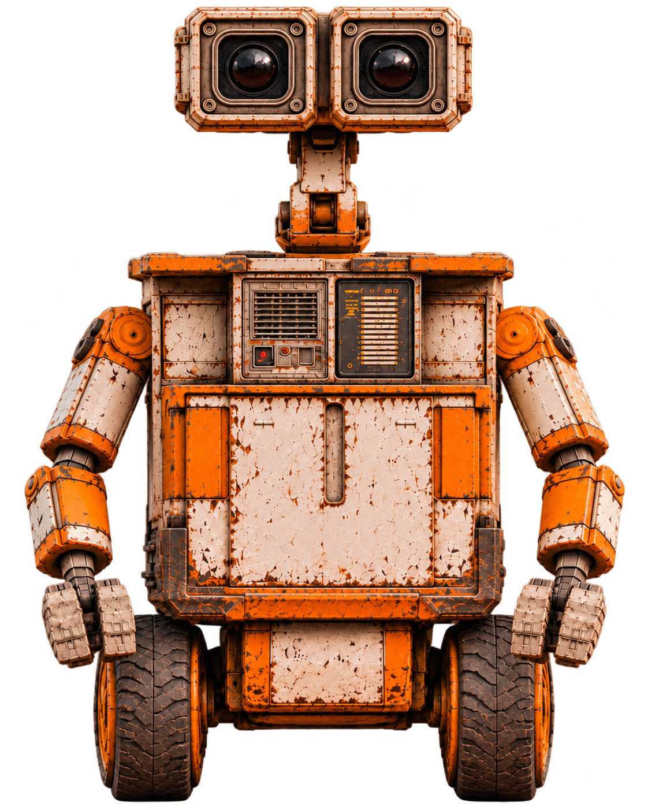
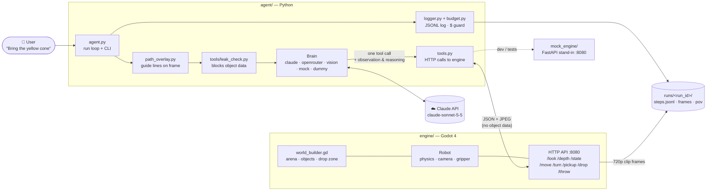

<div align="center">



# Pixie — a robot that fetches what you ask for, using only its eyes

**Hackoween · Membrane Robot Hackathon**

Type *"Bring the yellow cone"*. A wheeled robot in a 3D Godot world looks through its own camera,<br>
finds the object, picks it up and delivers it to the drop zone. **Claude never gets told where anything is.**

</div>

---

## Contents

- [What it does](#what-it-does)
- [How it works](#how-it-works)
- [Architecture](#architecture)
- [Repository layout](#repository-layout)
- [Install](#install)
- [Run the robot](#run-the-robot)
- [Robot actions](#robot-actions)
- [Engine API](#engine-api)
- [Testing without the real engine](#testing-without-the-real-engine)
- [Run logs and clips](#run-logs-and-clips)
- [Team and workflow](#team-and-workflow)

---

## What it does

| | |
|---|---|
| **Input** | A typed command, e.g. `"Bring the red cube"` or `"Bring the tallest object"` |
| **World** | An 8 m × 8 m Godot 4 arena with walls, five coloured physics objects and a magenta drop zone |
| **Robot** | A 0.6 m-wide wheeled robot with one forward camera (640×480, 90° field of view, 0.5 m high, tilted 10° down) |
| **Brain** | Claude (`claude-sonnet-5-5`) chooses every move from the camera image alone |
| **Output** | The object in the drop zone, plus a step-by-step log of what Claude saw and why it acted |

**The one hard rule:** the engine never tells the agent an object's name, colour, shape, ID, position or count. Claude has to find the object **from pixels**, the same way a real robot would. A leak checker enforces this on every single request.

## How it works

Each step of a run:

1. **Look.** The agent grabs the latest camera frame (`GET /look`) and a single depth reading (`GET /depth`).
2. **Overlay.** Two thin guide lines are drawn on the frame showing the strip of floor the robot will sweep if it drives straight, with distance ticks at 0.5–3 m. They come from fixed camera geometry only, so they add no object information.
3. **Check for leaks.** `tools/leak_check.py` scans everything about to be sent to Claude. Anything that looks like object data aborts the run.
4. **Decide.** Claude gets the command, the frame and a short summary of earlier steps, and calls exactly one tool (`move`, `turn`, `pickup`, `drop`, `throw` or `give_up`). Each call includes Claude's own `observation` and `reasoning`.
5. **Act.** The agent sends the action to the engine, which moves the robot with real physics and reports back (e.g. `{"moved": 0.5, "collided": false}`).
6. **Log.** The step, the frame Claude saw and its reasoning are saved to `runs/<run_id>/`.

On a collision the robot backs off 0.1 m and enters `Blocked`. Claude then picks a clearer route. The 4th collision ends the run.

More detail: [docs/how_claude_finds_objects.md](docs/how_claude_finds_objects.md).

## Architecture



| Part | Tech | Job |
|---|---|---|
| **Engine** | Godot 4.3 (GL Compatibility) | Builds the world at runtime, simulates the robot, renders the camera, serves the HTTP API on port 8080 |
| **Agent** | Python 3, `anthropic`, `requests`, `pillow`, `numpy` | Runs the look → decide → act loop, logs everything, keeps spending under budget |
| **Leak checker** | Python | Checks every engine reply against the exact contract and every Claude request for object words |
| **Mock engine** | FastAPI + Pillow | A 2D fake of the engine with the same API, for building the agent without Godot |
| **Landing page** | React + Vite + Tailwind | The project's showcase page |

## Repository layout

```
Hackoween/
├── engine/          Godot 4 project: world, robot, cameras, HTTP API (world_builder.gd)
├── agent/           Python agent: run loop, Claude client, prompts, tools, logging, budget
├── tools/           leak_check.py: guards the "no object data" rule
├── mock_engine/     FastAPI fake engine + contract_test.py (works on the real engine too)
├── frontend/        Pixie landing page (React + Vite + Tailwind)
├── docs/            how_claude_finds_objects.md
├── runs/final/      Logs from the judged hidden-command runs
├── .env.example     Template for your API keys (copy to .env)
└── plan.md          Roles, timeline, API contract and repo workflow
```

## Install

### Prerequisites

| Need | For | Get it |
|---|---|---|
| **Godot 4.3+** (standard, not .NET) | The 3D engine | [godotengine.org/download](https://godotengine.org/download) |
| **Python 3.10+** | Agent, leak checker, mock engine | [python.org](https://www.python.org/downloads/) |
| **Git** | Cloning | [git-scm.com](https://git-scm.com/) |
| Node.js 18+ *(optional)* | Landing page only | [nodejs.org](https://nodejs.org/) |

### Steps (Windows PowerShell)

```powershell
# 1. Clone somewhere outside OneDrive (OneDrive sync breaks Godot and venvs)
cd C:\dev
git clone https://github.com/yashhhvardhannn/Hackoween.git
cd Hackoween

# 2. Python environment
python -m venv .venv
.\.venv\Scripts\Activate.ps1
pip install -r agent/requirements.txt

# 3. API keys
Copy-Item .env.example .env
notepad .env        # paste your ANTHROPIC_API_KEY
```

`.env` settings:

| Variable | Default | What |
|---|---|---|
| `ANTHROPIC_API_KEY` | — | Required for `--mode claude` |
| `CLAUDE_MODEL` | `claude-sonnet-5-5` | Claude model used by the agent |
| `ENGINE_URL` | `http://localhost:8080` | Where the engine is listening |
| `OPENROUTER_API_KEY` | — | Optional, only for `--mode openrouter` |
| `OPENROUTER_MODEL` | `deepseek/deepseek-v4.1-flash` | Optional OpenRouter model |

> **Never commit `.env`.** It is in `.gitignore`.

## Run the robot

### 1. Start the engine

1. Open **Godot** → **Import** → choose `engine/project.godot` → **Import & Edit**.
2. Press **F5** (Play). The HTTP API starts on `localhost:8080`.

In the game window:

| Control | Action |
|---|---|
| Mouse drag / scroll | Orbit / zoom the third-person view |
| **V** | Switch view: behind / front / overhead |
| **W / S** | Drive 0.5 m forward / back |
| **A / D** | Turn 30° left / right |
| **E / Q / T** | Pick up / drop / throw |
| **R** | Reset the scene |
| **P** | Save the robot camera image to `user://look.jpg` |

The small view in the top-right corner is the robot's own camera, which is **exactly what Claude sees**.

Launch options (after `--`): `--view=front|behind|overview`, `--port=8081`.

Check it's up (second terminal):

```powershell
Invoke-RestMethod http://localhost:8080/state
```

### 2. Run the agent

From the repo root, with the venv active:

```powershell
python -m agent.agent "Bring the yellow cone" --mode claude --reset
```

| Flag | Meaning |
|---|---|
| `--mode claude` | Claude decides every step (judged runs) |
| `--mode openrouter` | Any OpenRouter vision model (dev only) |
| `--mode vision` | Pixel-colour stand-in brain, no API key needed (dev only) |
| `--mode mock` / `dummy` | Scripted / fixed moves for plumbing tests |
| `--reset` | Put the robot and objects back at their start positions first |
| `--final` | Marks a judged run. The budget guard always allows it. Practice Claude runs stop at $30 of the $40 budget |

> During a judged run, nobody touches the keyboard or mouse.

### 3. Landing page (optional)

```powershell
npm --prefix frontend install
npm run dev        # http://localhost:3000
```

## Robot actions

These are the tools Claude can call. Each also takes `observation` and `reasoning` strings.

| Tool | Range | Result |
|---|---|---|
| `move(distance)` | −3 … 3 m | Distance moved, whether it collided |
| `turn(degrees)` | −180 … 180° (positive = right) | Degrees turned |
| `pickup()` | Reach 0.5 m, ±30° | Success yes/no |
| `drop()` | — | Success, and whether it landed `in_zone` |
| `throw(distance)` | 0.5 … 4 m ahead | Success, `in_zone` |
| `give_up(reason)` | — | Ends the run |

There is deliberately **no `go_to` tool**. Claude plans the whole path with `move` and `turn` alone.

## Engine API

Base URL `http://localhost:8080`. Units are metres and degrees. Heading 0 = +x, positive = clockwise from above.

| Method | Path | Body | Reply |
|---|---|---|---|
| GET | `/state` | — | `{"state", "x", "y", "heading", "holding", "retries"}` |
| GET | `/look` | — | 640×480 JPEG from the robot camera |
| GET | `/depth` | — | `{"distance": metres or null}` (centre ray, max 10 m) |
| POST | `/move` | `{"distance": 0.5}` | `{"moved", "collided", "state"}` |
| POST | `/turn` | `{"degrees": 30}` | `{"turned", "state"}` |
| POST | `/pickup` | `{}` | `{"success"}` |
| POST | `/drop` | `{}` | `{"success", "in_zone"}` |
| POST | `/throw` | `{"distance": 2.0}` | `{"success", "in_zone"}` |
| POST | `/run/start` | `{"command", "run_id"}` | `{"ok"}`, starts 720p clip capture |
| POST | `/run/end` | `{"outcome"}` | `{"ok"}`, stops capture |
| POST | `/reset` | `{}` | `{"ok"}` |

States: `Idle` · `Locate` · `GoToObject` · `PickUp` · `Carry` · `Drop` · `Done` · `Blocked`.

Full contract: [plan.md §2](plan.md). Engine details: [engine/README.md](engine/README.md).

## Testing without the real engine

The mock engine answers the same API with a simple 2D drawing, so you can work on the agent without Godot:

```powershell
pip install -r mock_engine/requirements.txt
python mock_engine/server.py                    # terminal 1
python mock_engine/contract_test.py --fetch     # terminal 2: every line should say PASS
```

`contract_test.py` also checks the real engine: `python mock_engine/contract_test.py --url http://localhost:8080`.

Leak checker self-test and run scan:

```powershell
python tools/leak_check.py --selftest
python tools/leak_check.py runs/<run_id>
```

More: [mock_engine/README.md](mock_engine/README.md).

## Run logs and clips

Every run writes to `runs/<run_id>/`:

| File | What |
|---|---|
| `steps.jsonl` | One line per step: tool, arguments, engine result, Claude's `observation` and `reasoning`, frame path |
| `frames/step_XX.png` | The exact image Claude saw at each step |
| `pov/` | 720p frames captured while the robot moves, used to build the clips |

The judged hidden-command runs are committed under [`runs/final/`](runs/final/).

## Team and workflow

| Who | Owns |
|---|---|
| **Yash** | `engine/`: world, robot, physics, cameras, HTTP API · demo machine |
| **Aadya** | `agent/`: Claude loop, prompts, logging, budget |
| **Shaun** | `mock_engine/`, `runs/final/`, README, repo and merges into `main` |
| **Abhinav** | `tools/`, `docs/`: leak checker, QA, documentation |

**Rules:** each person works on their own branch and only edits the folders they own, so merges never clash. Open a PR into `main` and leave the merge to the repo captain. Full workflow: [plan.md §3a](plan.md).
